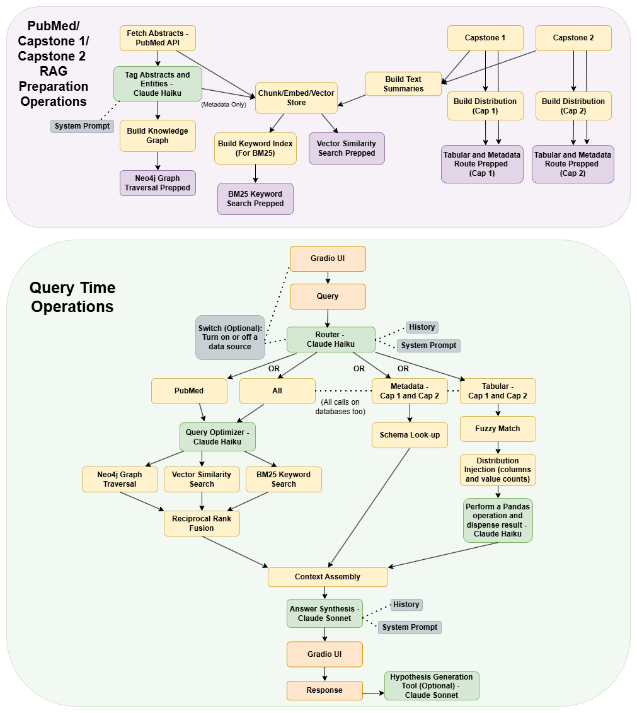

# Hi, I'm Katie! 👋

Welcome to my academic portfolio, featuring projects from my M.S. in Data Science at the University of Virginia.

📫 [LinkedIn](https://www.linkedin.com/in/kdunning0/) · [Email](mailto:kadunning0@gmail.com)

## Projects

Selected work from my M.S. in Data Science at the University of Virginia (2026). Each entry covers the problem, how it was approached, and what came out of it.

- [NADIA: Hybrid Retrieval-Augmented Generation for Stroke Research](#nadia-hybrid-retrieval-augmented-generation-for-stroke-research)
- [Skin Lesion Classification: An Ablation Study with EfficientNet-B4](#skin-lesion-classification-an-ablation-study-with-efficientnet-b4)
- [Finding Displaced People After the 2010 Haiti Earthquake](#finding-displaced-people-after-the-2010-haiti-earthquake)
- [Petrichor: A Hybrid-Retrieval RAG Assistant for Tabletop Game Masters](#petrichor-a-hybrid-retrieval-rag-assistant-for-tabletop-game-masters)
- [What Unites Fear? Text Analysis of Classic Horror, 1764–1936](#what-unites-fear-text-analysis-of-classic-horror-17641936)
- [Predicting Home Prices and Quality in King County, WA](#predicting-home-prices-and-quality-in-king-county-wa)
- [Testing a Retailer's Claims: What Drives Diamond Price?](#testing-a-retailers-claims-what-drives-diamond-price)
---

## NADIA: Hybrid Retrieval-Augmented Generation for Stroke Research
*Team project (4 members), MSDS Capstone, University of Virginia · Sponsored by the UVA Health stroke research group* · Restricted Access. Please contact me directly to request a Demo or information on the code.

**Summary.** Stroke researchers deciding whether a research question is worth pursuing have to answer two things at once: what the published literature already says, and whether their own data can support the study. NADIA (Neurological Abstract and Database Intelligence Assistant) is a research-support tool that answers both from one interface. Its literature pipeline searches a candidate pool of up to ~10,300 PubMed records, restricts them to 16 sponsor-selected journals, and keeps the top 1,000 by relevance, which yields about 730 usable abstracts after filtering. It pairs that literature with a clinical stroke registry and a synthetic administrative claims dataset to help researchers refine questions, check data feasibility, and find gaps in the literature.

**Method.** At build time, the pipeline pulls abstracts from PubMed's API and uses Claude Haiku to tag each one by stroke subtype and clinical focus and to extract entities (drugs, genes, biomarkers, conditions). It then indexes the abstracts three ways: as embeddings in a Chroma vector store, as a BM25 keyword index, and as an article–entity knowledge graph in Neo4j. At query time, an LLM router sends each question to literature retrieval, dataset metadata lookup, tabular analysis (LLM-generated pandas code run against the structured data), or a combination. Literature results from the three retrievers are merged with reciprocal rank fusion, and Claude Sonnet writes a cited answer. The system also includes a MeSH-based query optimizer and a hypothesis generator that uses the knowledge graph to find contradictions and unexplored connections. It's served through a Gradio interface hosted on Hugging Face Spaces.

**Results.** We delivered a working end-to-end prototype and demonstrated it to the sponsor group, who saw it as a strong foundation for continued development and handed it off with documentation and the full codebase. Answers cite PubMed sources by PMID and label structured-data results by source. Tabular follow-ups ("those patients," "how did you get that number?") reuse the exact code from the earlier question. In cost testing, one-time build processing ran about $1.17, and queries averaged roughly $0.05 each. Evaluation was qualitative, through sponsor testing and review. A formal retrieval benchmark wasn't feasible because existing benchmark datasets contain too few stroke-specific questions.

**My role:** One of the main pipeline builders. Led testing and codebase validation, co-wrote the final report, and led client demonstrations and technical presentations. Also validated compatibility with UVA's HPC environment and optimized LLM routing and performance.

**System Diagram:**

  

---

## Skin Lesion Classification: An Ablation Study with EfficientNet-B4
*Team project (4 members), DS 6050 Deep Learning, University of Virginia* · [Repo](https://github.com/KDunning0/ds6050_team3_ablationstudy)

**Summary.** Skin lesion classifiers trained on the ISIC 2019 dataset (25,331 dermoscopic images across 8 lesion types) struggle because the data is small and heavily imbalanced. Benign moles make up half the images, and the rarest class is under 1%. Our team tested whether three techniques from the literature improve classification, alone and in combination: equilibration mini-batch (EM) sampling to balance classes within each batch, ImageNet transfer learning, and MetaBlock, an attention mechanism that combines patient age, sex, and lesion location with the image features.

**Method.** We ran a two-track ablation study on EfficientNet-B4 in PyTorch. One track trained from scratch and the other fully fine-tuned from ImageNet weights. Each track compared a baseline against EM sampling, MetaBlock, and both together. A supplementary run replaced EM sampling with inverse-frequency weighted cross-entropy loss. We tuned hyperparameters with Optuna (40 trials per track) on UVA's Rivanna GPU cluster. Models were evaluated on the official test set, with the unknown class removed, using macro-average recall (MAR), which weights every class equally.

**Results.** Transfer learning was the largest improvement by far, raising test MAR from 0.395 to 0.549, a 39% relative gain. EM sampling hurt both tracks. The drop was clearest with transfer learning (0.549 → 0.526), which suggests that forcing balanced batches works against what the pretrained weights already learned. MetaBlock hurt the scratch model but slightly improved the transfer learning model (0.555). Combining EM and MetaBlock had a mild synergistic effect but still didn't beat either baseline. The best model used transfer learning with weighted loss in place of EM sampling (test MAR 0.586), so class imbalance was better handled at the loss level than by resampling the data.

**My role:** Wrote the model, training runner, and hyperparameter tuning code; ran Optuna tuning and the baseline training runs; built the metric visualizations.

---

## Finding Displaced People After the 2010 Haiti Earthquake
*Team project (4 members), DS 6030, University of Virginia* · [Request Access to Project Folder](https://drive.google.com/drive/folders/16BL51N8h9MJG0KDXZ8ZmiZswtDk_zRtf?usp=drive_link)

**Summary.** After the 2010 Haiti earthquake, many displaced people sheltered under blue tarps, so finding tarps in aerial imagery is a way to direct aid to them. Our team built classifiers that flag blue-tarp pixels using only their RGB values. We trained on 63,241 labeled pixels (3% tarps) and tested on a 1,024,899-pixel holdout set where tarps made up only 1.4%.

**Method.** The holdout files came without channel labels. We identified which column was red, green, and blue by checking known tarp colors against a color picker and matching channel density curves to the labeled training data. Exploratory analysis showed that raw channel values overlapped heavily between tarps and other terrain, and that what set tarps apart was blue relative to red and green: blue/red and blue/green ratios separated the classes cleanly. We compared six classifiers in R/tidymodels, all fit on the normalized RGB channels: LDA, QDA, KNN, penalized logistic regression, random forest, and polynomial SVM. Hyperparameters were tuned on ROC AUC with Latin hypercube grids under stratified 10-fold cross-validation, so every fold contained tarp examples. Because the classes were so imbalanced, we chose each model's decision threshold by maximizing F1 on out-of-fold cross-validation predictions, and compared models mainly on F1 and AUC rather than accuracy.

**Results.** Every model had a cross-validated AUC of at least 0.98, but the holdout set separated them. Random forest scored best in cross-validation but had the largest drop in F1 on new data. Penalized logistic regression generalized best, with a test AUC of 0.999 and the highest test F1 of any model at the standard 0.5 threshold (0.80, detecting 98% of tarp pixels). Thresholding was also informative. The F1-optimal threshold from cross-validation (0.31) did worse on the holdout (F1 0.69), because tarps were less than half as common there as in training, so the tuned threshold produced more false alarms. At that threshold, though, the model caught 99% of tarps, which is the right trade-off for aid delivery: a missed tarp means people who don't get help.

**My role:** Contributed equally across all stages: data preprocessing, exploratory analysis, model tuning, evaluation, and the final presentation.

---

## Petrichor: A Hybrid-Retrieval RAG Assistant for Tabletop Game Masters
*Individual project, DS 5002, University of Virginia* · [Repo & Model Card](https://github.com/KDunning0/Petrichor_Game_Master_Project)

**Summary.** Petrichor helps tabletop RPG game masters generate plot hooks, characters, and thematic traps that fit their campaign. It grounds generation in a static corpus of 32 Project Gutenberg novels plus TTRPG rulebooks and scenario books, and can also draw on a game master's own campaign notes.

**Method.** The system uses two retrieval paths. The static corpus is searched with hybrid retrieval: BGE-M3 dense embeddings and BM25, weighted equally. Campaign notes go through a separate pipeline in which Claude Haiku extracts entities into a Neo4j knowledge graph, and the two result sets are merged with reciprocal rank fusion. Claude Sonnet generates the final response. I benchmarked Petrichor against base Claude, GPT-4.1, Gemini 3.1 Pro, and Gemma 4 12B (with and without RAG) using LLM-as-judge evaluation with DeepEval and RAGAS on three test sets: handwritten TTRPG queries, general creative-writing prompts, and synthetic questions generated from the corpus.

**Results.** Retrieval made outputs more usable at the table. Actionability rose from 0.82 to 0.86 on TTRPG queries and from 0.44 to 0.55 on general prompts, and answers stayed highly faithful to retrieved sources (0.98). On corpus-grounded questions, answer correctness rose from 0.38 to 0.50, ahead of GPT-4.1 (0.46) and Gemini 3.1 Pro (0.42). The trade-off was a drop in narrative specificity and tonal coherence compared with base Claude, and contextual relevancy was low (about 0.2), so retrieval precision is the clearest next improvement. Full benchmark tables and limitations are in the model card.

---
## What Unites Fear? Text Analysis of Classic Horror, 1764–1936
*Individual project, DS 5001, University of Virginia* · [Request Access to Project Folder](https://drive.google.com/drive/folders/1afSNm7p6RUBpdwLauXFmKrr85ZX1rfhq?usp=drive_link))

**Summary.** What makes horror one genre, and how does it change across subgenre, culture, and time? I built a corpus of 31 horror novels from Project Gutenberg, from *The Castle of Otranto* (1764) to H.P. Lovecraft, split into 866 chapters. I labeled each novel by subgenre (Gothic, Cosmic/Weird, Vampire, Sci-Fi, and six others), by culture (nine national traditions), and by decade. Then I tested which of those groupings actually show up in the text.

**Method.** I wrote custom regex chapter parsers for each book to strip the Gutenberg front and back matter. The text was then tokenized and part-of-speech tagged into a hierarchical paragraph–sentence–token table. Four methods each looked at a different layer of the text. PCA on chapter-level TF-IDF (with proper nouns removed) measured differences in vocabulary. LDA with 50 topics, fit on the nouns in each paragraph, measured themes; I used paragraphs because fitting on whole chapters collapsed into a few topics. Word2Vec with t-SNE mapped how words relate to each other. The NRC emotion lexicon scored sentiment. Each grouping was compared using PCA projections, hierarchical clustering of topic profiles, and sentiment heatmaps.

**Results.** Sentiment is what holds the genre together. Trust and fear are the strongest emotions in nearly every subgenre, culture, and decade, and anticipation consistently outscores surprise, which suggests these books build dread more than they rely on shock. The most common topic centers on the mind and the human condition ("mind, death, feelings, thoughts, existence"). Subgenres separate well by topic but much less by vocabulary. Psychological and Sci-Fi were almost indistinguishable, and Gothic and Vampire were the closest pair. Culture didn't separate cleanly, even among the three largest groups (English, Irish, American). Time sometimes connected books across categories: Poe and Lovecraft clustered together despite being a century apart. One limitation is that many cultures and decades are represented by only one or two novels, so those groupings are suggestive at most.

---

## Predicting Home Prices and Quality in King County, WA
*Team project (4 members), DS 6021, University of Virginia* · [Request Access to Project Folder](https://drive.google.com/drive/folders/10Z3N0yMOLEED3JPxmrZBdK2WIDSAmdkJ?usp=drive_link)

**Summary.** Using 21,613 home sales from King County, Washington (2014–2015), our team built models for two questions: what a home will sell for, and whether it is "good quality." King County defines good quality as above-average scores on both construction grade and condition. We fit two price models for different audiences, one on the full market including luxury homes, and one for typical buyers with the most expensive 2.5% of homes (≥ $1.495M) removed. A third model classifies home quality.

**Method.** Data cleaning came first. We checked records with impossible values (0 bedrooms, 0 bathrooms) against county parcel records and fixed or removed them. We also removed homes whose estimated building footprint was larger than the lot. We engineered features for sale season, renovation era, share of living space above ground, and city (assigned from zip code). Highly correlated predictors were dropped after checking a correlation matrix and VIF. We used stepwise AIC search and best-subsets comparison (BIC, Mallows' Cp) to compare candidate models. Box-Cox analysis and the residual plots called for a log transformation of price. We used Cook's distance and DFFITS to find influential points, which turned out to be mansions rather than data errors, and that finding motivated the separate luxury-excluded model. The quality classifier is a logistic regression, evaluated on a held-out test set at several probability thresholds and with an ROC curve.

**Results.** Construction grade, living area, waterfront location, and city were the strongest price drivers in both models. Removing luxury homes cut test RMSE from about $262K to $161K. The typical-buyer model explained 77% of the variance in log price. The quality classifier had an AUC of 0.90. Only about 12% of homes were good quality, so the classification threshold controls a real trade-off. At 0.5, the model almost never labeled a poor home as good (99% specificity) but caught only 7% of the good homes. Lowering the threshold to 0.2 caught 60% of good homes, with specificity at 84%. That lets the model be tuned for a cautious homebuyer or for an investor looking for undervalued properties.

**My role:** Contributed equally across all stages: data cleaning, exploratory analysis, modeling, and the final report.

---

## Testing a Retailer's Claims: What Drives Diamond Price?
*Team project (4 members), DS 6021, University of Virginia* · [Request Access to Project Folder](https://drive.google.com/drive/folders/1WLRADshsFQHlZhqZWbLCnVazQxPbHdk4?usp=drive_link)

**Summary.** Blue Nile, an online diamond retailer, tells shoppers how to rank the "4Cs." It says cut matters most for how a diamond looks, followed by color and then clarity, and that carat weight is the biggest driver of price. Our team tested those claims against 1,214 diamonds from Blue Nile's inventory. We looked at two questions: how the 4Cs are distributed across the stock, and how each one relates to price.

**Method.** We worked in R (tidyverse, ggplot2). We started with univariate distributions of each C, then ran pairwise comparisons using paired heatmaps for every combination of the 4Cs, one showing share of stock and one showing average price. To keep carat from confounding the categorical comparisons, we split diamonds into carat bins. Within each bin, we compared the price gained by moving up one carat bin with the price gained by moving to the best grade of cut, color, or clarity. We then fit a simple linear regression of price on carat. The untransformed model showed curvature and non-constant variance in the residuals. Box-Cox analysis pointed to a power transformation, and a square-root transformation of price best corrected the residual problems.

**Results.** The data supported the claim that carat drives price. On the square-root price scale, carat alone explained 89.6% of the variance (R² = 0.896, p < 2.2e-16). Moving up one carat bin raised average price more than moving to the best cut in every bin. It also beat moving to the best color for diamonds under 1.5 carats and the best clarity for diamonds under 0.75 carats, which together cover most of the stock. Above those sizes, color and clarity took over as the larger price factors. Cut had the least effect on price. Very Good cuts actually averaged higher prices than Ideal cuts, because the Very Good cuts tended to be heavier stones. The inventory itself followed Blue Nile's appearance ranking: Ideal cuts were the majority at every color grade, and clarity was spread fairly evenly across mid-level grades. That supports cut > color > clarity as a stocking priority.

**My role:** Owned the analysis of cut across the project: its distribution in the inventory, its pairwise comparisons with carat, color, and clarity, and its relationship to price.
